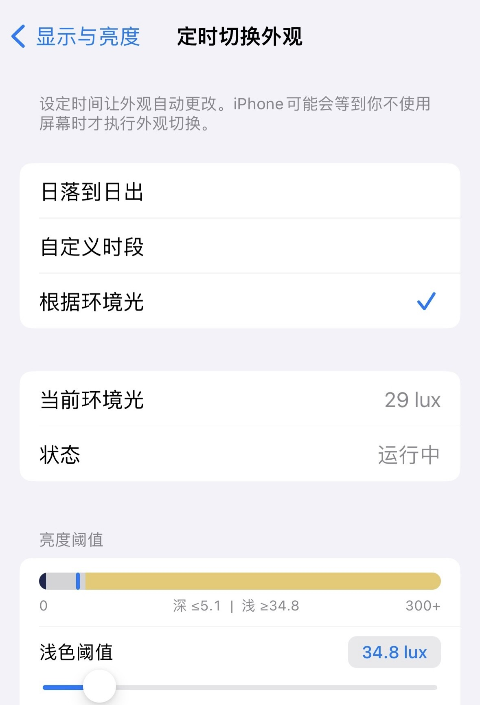
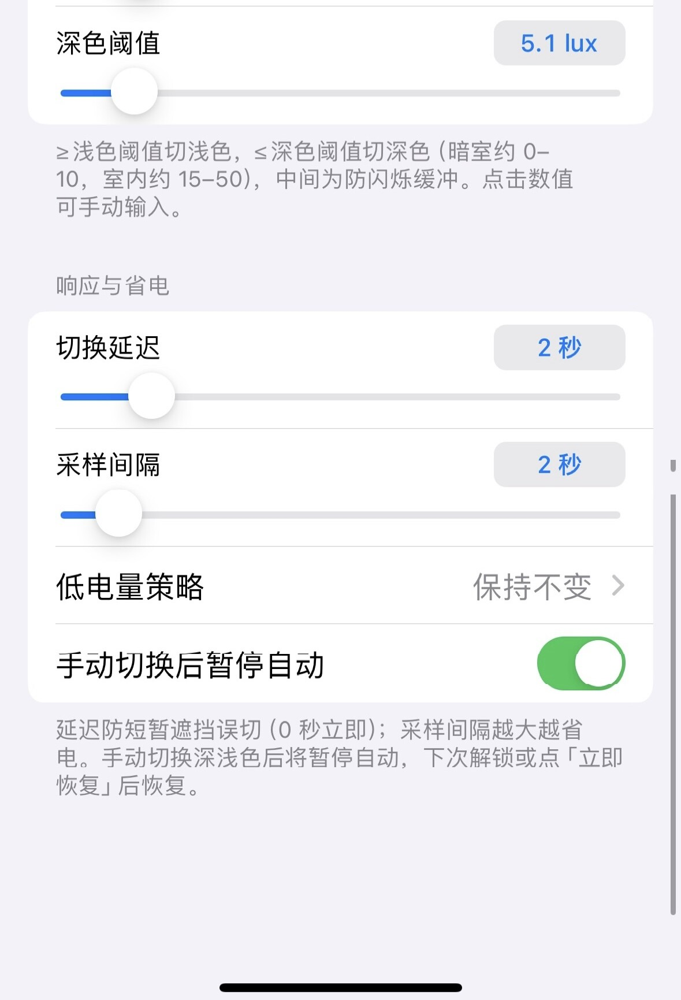

# SenseDark（光感深色）

Automatically switches iOS Light/Dark appearance based on the ambient light sensor.

Settings live in native **Settings → Display & Brightness → Automatic → Options** as a third option, **Ambient Light**, next to *Sunset to Sunrise* and *Custom Schedule*. Selecting it expands controls for light/dark thresholds, switch delay, sampling interval, Low Power Mode policy, manual-switch pause, and a live lux readout. A standalone Settings pane jumps to Display & Brightness and lets you switch language (Follow System / 简体中文 / English / Русский).

中文说明见[下方](#中文说明)。

## How it works

- SpringBoard reads the ambient light sensor via `IOHIDEventSystemClient` (vendor page `0xff00`, usage `4`) and publishes the live lux reading and state to Settings.
- Appearance switches through UIKit's `UISUserInterfaceStyleMode`. When native *Automatic* is on, it uses `setOverride:` so the system toggle stays enabled and the *Options* row stays in place.
- Two thresholds (defaults: light ≥ 25 lux, dark ≤ 10 lux) and a hold delay (default: 2 s) avoid flicker near the boundary or from brief shadows.
- Manual toggles in Control Center or Settings pause automation until the next unlock (or until resumed manually).
- Sampling stops while the screen is off and resumes on unlock. Low Power Mode can keep normal sampling, slow down, or pause switching.

Core sensor subscription and switching follow [skittyblock/LightsOut](https://github.com/skittyblock/LightsOut) (GPLv3); the Options integration, schedule coexistence, debounce, Low Power Mode handling, localization, and roothide support are written from scratch.

## Install & Compatibility

Add `https://repo.rusti.cc/ios/` in Sileo or Zebra and install `SenseDark (roothide)` or `SenseDark (rootless)` for your jailbreak, or download a `.deb` from Releases and install with `dpkg -i`. Requires `mobilesubstrate` (ElleKit) and `preferenceloader`.

Developed and tested on iOS 17.2 (roothide Bootstrap). The `rootless` package builds, but has not been tested on a rootless device.

## Build

```bash
git clone https://github.com/starmoor/SenseDark.git && cd SenseDark
# roothide (requires the roothide theos fork)
THEOS=~/theos-roothide make package THEOS_PACKAGE_SCHEME=roothide FINALPACKAGE=1
# rootless
THEOS=~/theos make package THEOS_PACKAGE_SCHEME=rootless FINALPACKAGE=1
```

---

## 中文说明

**光感深色（SenseDark）**，根据环境光传感器（lux）自动切换 iOS 系统浅色/深色外观的越狱插件。

配置直接放在原生 **设置 → 显示与亮度 → 自动 → 选项** 里，在「日落到日出」「自定义时段」之外多出第三项**「根据环境光」**。选中后在原地展开浅色/深色阈值、切换延迟、采样间隔、低电量策略、手动切换暂停与实时环境光读数。设置主列表另有一个入口页，用来直接跳转「显示与亮度」以及切换界面语言（跟随系统 / 简体中文 / English / Русский）。

- 仅由 SpringBoard 订阅环境光传感器（`IOHIDEventSystemClient`），通过 `UISUserInterfaceStyleMode` 切换外观；系统「自动」开启时改用 `setOverride:`，不会把「自动」开关弹回关闭。
- 双阈值滞回（默认浅色 ≥ 25 lux、深色 ≤ 10 lux）配合切换延迟（默认 2 秒）防临界闪烁或瞬时遮挡误触。
- 灭屏停采样，解锁恢复；支持在低电量模式下保持不变、降频采样或暂停切换；在控制中心或设置手动切换外观后暂停自动，下次解锁恢复。
- 核心传感器订阅与切换思路参考 [skittyblock/LightsOut](https://github.com/skittyblock/LightsOut)（GPLv3），选项页集成、防抖、低电量策略、多语言与 roothide 适配均为重写实现。
- 安装方式：在 Sileo / Zebra 添加源 `https://repo.rusti.cc/ios/`，按越狱类型安装 `SenseDark (roothide)` 或 `SenseDark (rootless)`，或从 GitHub Releases 下载 `.deb` 手动安装。依赖 `mobilesubstrate`（ElleKit）与 `preferenceloader`。
- 实测环境为 iOS 17.2（roothide Bootstrap）；`rootless` 包已提供构建但未在真机上测试。

---

## Screenshots / 示例截图

<p> </p>
